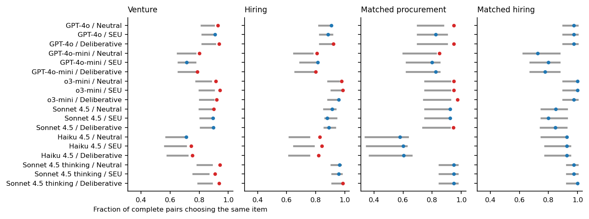
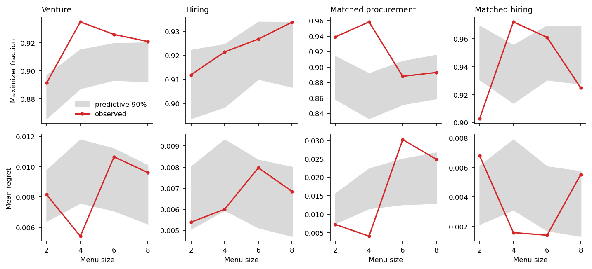
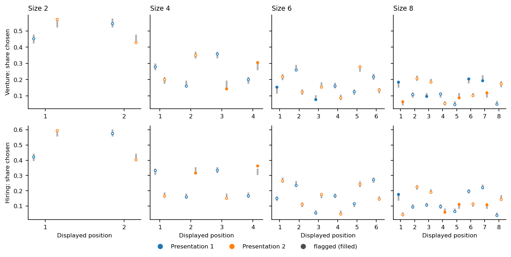

::: {.callout-warning title="Draft for review"}
This is review draft 1 of the results report, prepared November 4, 2026. It has not yet been reviewed by the author or an independent reviewer. Where its wording differs from the [preregistration and its amendments](../../../applications/seu_sensitivity_study/PREREGISTRATION.md), the preregistration controls.
:::

## Purpose and Scope {#sec-purpose}

This report presents the results of the SEU sensitivity study, whose motivation, design, and analysis plan are described in the companion [design report](01_study_design.qmd). The study asks how closely the choices of six language-model configurations ("arms") conform to subjective expected utility (SEU) maximization, judged against each arm's *own* previously stated probability assessments, and how that conformity changes with the choice instruction, the decision domain, a matched task context, and the number of alternatives on the menu.

The intended readers are behavioral scientists, data scientists, and AI safety researchers who want enough detail to judge what was done and why, not only what was found. The report is therefore deliberately more explicit than a journal article. It restates the measurement model, the estimands, and the decision rule, reports every member of the preregistered decision family rather than a selection, and places each result next to the analyses that qualify it. Readers who want the full rationale for a design choice will find it in the design report; this report cross-references rather than repeats that material.

Everything numerical in this report is generated. Tables and the numbers quoted in the text are produced by an evidence exporter from the saved analysis artifacts; no estimate has been typed by hand. @sec-reproduction describes how the generated files are checked.

### What the Study Measures, in Brief

For each arm, a neutral prompt first elicited a probability assessment of three ordered consequences (for example: loss, break-even, high return) for each of 60 synthetic alternatives per pool. These probabilities were saved. Later, in separate requests, each arm chose one alternative from menus of two, four, six, or eight of those alternatives, under three instructions: a neutral instruction, an instruction to maximize subjective expected utility, and an instruction to think carefully step by step. The analyst assigns utilities 0, 0.5, and 1 to the three consequences, so every alternative has a fixed expected utility computed from the arm's own probabilities.

A softmax choice model then estimates *sensitivity*, a parameter $\alpha$ describing how sharply choices favor alternatives with higher assessed expected utility. Larger $\alpha$ means choices track the assessment-implied ranking more closely. The results are therefore measures of **assessment-conditioned conformity**: whether an arm acts in line with its own stated assessments under the analyst's utility assignment. They are not measures of decision quality, accuracy, fairness, or suitability for deployment, and high conformity says nothing about whether the stated assessments are well grounded.

### Reading Guide

@sec-summary gives the findings and their main qualifications on one page. @sec-reading restates what is needed to interpret the numbers. @sec-conduct describes how collection and estimation actually proceeded, including every deviation and unplanned event. @sec-observed describes the raw choices before any modeling. @sec-primary reports the primary decisions, @sec-descriptive the preregistered descriptive analyses, @sec-sensitivity the sensitivity analyses, and @sec-checks the model checks. @sec-synthesis brings these together and discusses implications for each audience. @sec-limitations states the limitations, and the appendices contain complete tables and provenance.

## Summary of Findings {#sec-summary}

All  planned posterior fits passed the frozen sampler gates, and all  named primary decisions were available ( distinct up to sign). Under the preregistered rule,  of the  are detections:  in venture,  in hiring, and  in the matched hiring-versus-procurement comparison. There is no multiplicity adjustment; the full family is shown in @fig-decisions.

1. **Flagship arms are more sensitive than the small arms of the same vendor, in both domains.** GPT-4o's prompt-averaged sensitivity exceeds GPT-4o-mini's by a factor of  in venture and  in hiring (posterior median ratio and central 90% interval). Sonnet 4.5 exceeds Haiku 4.5 by  and . These detections persist in both presentation-only fits, both utility variants, and all three alternative priors. In the outcome-selected position-stable subset (finding 6), only the venture OpenAI contrast keeps its positive detection.
2. **There is no single ordering of the reasoning-capable arms across domains.** Relative to GPT-4o, o3-mini and Sonnet 4.5 with extended thinking are less sensitive or not detectably different in venture, but more sensitive in hiring. Between the two domains,  RQ1 contrasts differ with a 90% interval excluding zero, and median signs disagree for  of them (descriptive RQ4).
3. **Naming the SEU objective or asking for step-by-step thought produced no detected change.** None of the four instruction contrasts is detected. In hiring, the SEU-instruction interval,  on the log scale, barely excludes zero but its median lies inside the region of practical equivalence. Non-detection is not evidence that the instructions have no effect.
4. **In the matched comparison, hiring choices are more sensitive than procurement choices for GPT-4o, GPT-4o-mini, and Haiku 4.5.** The ratios are , , and . The GPT-4o result rests partly on hiring cells in which every informative choice selected an assessed maximizer, so its upper range is set by the prior and pooling rather than by the data. It is also not detected in the presentation-1-only fit.
5. **The preregistered menu-size slope is positive in both domains, but this result is fragile.** Sensitivity rises by a factor of  (venture) and  (hiring) per added alternative, and both are detected. However, the fitted model does not reproduce many observed size trends ( trend rows flagged in venture). The raw choices suggest that the size pattern differs between arms, whereas the model has a single slope per pool. The slope is also absent (venture) or reversed (hiring) in the position-stable subset.
6. **The preregistered position-stability robustness check did not confirm sign stability.** On the subset of menus where every cell chose the same item in both presentations,  venture and  hiring estimands change sign or decision label. This subset is small, selected on observed agreement, and dominated by menus on which all arms chose the same item. It is therefore a severe and different conditioning rather than a correction (@sec-stable). The results are nonetheless reported as not robust to this check.
7. **The independent-choice model understates how often an arm repeats its choice when the same menu is shown in reversed order.** Observed same-item repetition was  in venture against a predictive interval of , with similar excesses in hiring and matched procurement. Uncertainty for comparisons that rely on repeated menus may therefore be understated. Every RQ1 and RQ2 row has at least one contributing cell with this flag, as do several RQ5 rows, including the detected GPT-4o and GPT-4o-mini contrasts.

Overall, the arm differences in finding 1 are the most robust results in the study. The domain dependence of the reasoning-capable arms (finding 2) and the task differences (finding 4) are supported under most checks but carry specific qualifications. The size slope (finding 5) should be treated as provisional. None of these results is a statement about which model makes better decisions.

{#fig-decisions}

## How to Read the Estimates {#sec-reading}

This section restates the parts of the design that are needed to interpret every number in the report. The design report gives the reasons for each choice.

### Measurement Model

For model arm $a$, pool $p$, and alternative $r$, the neutral assessment supplies a probability vector $\boldsymbol q_{a,p,r}$ over three ordered consequences. With utilities $(0, u, 1)$ and primary midpoint $u=0.5$, the fixed expected utility is

$$
\eta_{a,p,r} = 0.5\,q_{a,p,r,2} + q_{a,p,r,3}.
$$ {#eq-eta}

The same $\eta$ is used under all three instructions for that arm and pool. Given a menu $\mathcal A_m$ shown to cell $c$ (an arm-by-instruction combination), the probability of choosing $r$ is

$$
\Pr(Y_m=r) = \frac{\exp(\alpha_m\eta_{r})}{\sum_{t\in\mathcal A_m}\exp(\alpha_m\eta_{t})},
\qquad
\log\alpha_m = \ell_{c[m]} + \gamma_{\mathrm{size}}\,s_m,
$$ {#eq-softmax}

where $s_m$ is the menu size minus the fit's mean retained menu size and

$$
\ell_c = \gamma_0 + \boldsymbol X_c\boldsymbol\gamma + \sigma_{\mathrm{cell}} z_c
$$ {#eq-cell}

is the *realized cell log sensitivity*: an intercept, additive arm and instruction effects, and a cell-specific deviation. The priors are $\gamma_0\sim\mathcal N(2.5,0.5)$, each $\gamma_j\sim\mathcal N(0,0.5)$, $\sigma_{\mathrm{cell}}\sim$ half-normal with scale 0.3, $\gamma_{\mathrm{size}}\sim\mathcal N(0,0.2)$, and $z_c\sim\mathcal N(0,1)$ ([design report](01_study_design.qmd#sec-analysis)).

Two consequences of @eq-softmax are worth stating. First, for any two alternatives on the same menu the log odds of choosing one over the other equal $\alpha_m(\eta_r-\eta_t)$, so $\alpha$ converts a difference in assessed expected utility into a difference in log odds. Second, $\alpha$ is not a probability of choosing the best alternative. The maximizer probability depends on the whole menu, and it falls mechanically as lower-valued alternatives are added even when $\alpha$ is constant.

### What a Sensitivity Value Means

Expected utilities lie between 0 and 1. A difference of $\Delta\eta=0.05$ corresponds, for example, to moving 10 percentage points of probability from the middle consequence to the best one, or 5 points from the worst to the best. @tbl-illustration translates each arm's neutral-instruction sensitivity into the implied probability of choosing the better of two alternatives that differ by $\Delta\eta=0.05$ or $0.10$. For instance, the venture estimates imply that Haiku 4.5 picks the better of two such alternatives with probability  at $\Delta\eta=0.05$, whereas GPT-4o does so with probability . This table is an illustration added for interpretation. It is not a preregistered analysis and carries no decision.



### Estimands and Contrasts

All primary comparisons are differences of realized cell log sensitivities, averaged with fixed equal weights (Amendment 5):

- **RQ1 (arms):** for arms $a$ and $b$ in pool $d$, $\tfrac13\sum_p(\ell_{a,p,d}-\ell_{b,p,d})$, averaged over the three instructions. Five arms are compared with GPT-4o, plus the OpenAI (GPT-4o minus GPT-4o-mini) and Anthropic (Sonnet 4.5 minus Haiku 4.5) flagship-minus-small contrasts. The OpenAI contrast is exactly the negative of the GPT-4o-mini-minus-GPT-4o contrast; both are retained because both were named in advance.
- **RQ2 (instructions):** $\tfrac16\sum_a(\ell_{a,p,d}-\ell_{a,\mathrm{neutral},d})$ for the SEU and deliberative instructions, averaged over the six arms.
- **RQ5 (task context):** for each arm, $\tfrac13\sum_p(\ell_{a,p,\mathrm{hiring}}-\ell_{a,p,\mathrm{procurement}})$, from a dedicated fit of the matched hiring and procurement items.
- **RQ6 (menu size):** $\gamma_{\mathrm{size}}$ in each pool, the change in log sensitivity per added alternative.

Exponentiating a contrast gives a ratio of geometric-mean sensitivities. A ratio of 2 means that, for the same difference in assessed expected utility, the log odds of the higher-valued alternative are twice as large. It does not mean that the maximizer is chosen twice as often.

### Decision Rule and Family

For a contrast with posterior 5th percentile $L$, median $M$, and 95th percentile $U$, a **detection** requires both that the central 90% interval excludes zero and that the median lies outside the region of practical equivalence (ROPE):

$$
(L>0 \text{ or } U<0)\quad\text{and}\quad |M| > \rho,
$$ {#eq-decision}

with $\rho=\log 1.25$ for RQ1, RQ2, and RQ5 and $\rho=\log 1.05$ per added alternative for RQ6. Direction follows the median. The interval need not lie entirely outside the ROPE. A contrast that does not meet the rule is *not detected*, which leaves it unresolved; it is not evidence of equivalence or of no effect.

The family has $2\times(7+2+1)+6=26$ named decisions: seven RQ1, two RQ2, and one RQ6 decision per pool, plus six RQ5 decisions. These are 24 distinct comparisons up to sign. There is no multiplicity adjustment; hierarchical shrinkage and the ROPE were the predeclared mitigations, and every member of the family is reported. The matched fit's size slope is reported as a sensitivity estimate only and is not a 27th decision.

### What Is Descriptive

Several preregistered analyses are descriptive by design. They add context and qualifications but never add, cancel, or replace a decision:

- RQ3 (model-by-instruction heterogeneity) and RQ4 (agreement across the two domains);
- the Amendment 6 assessment-scale transformation and the Amendment 9 Sonnet thinking-versus-base comparison;
- the presentation, utility, prior, and position-stability sensitivity analyses;
- the Amendment 7 ceiling diagnostics and the Amendment 8 posterior predictive checks.

When a sensitivity analysis applies the decision rule, the result is an *annotation*, for example "prior-sensitive under prior H", not a decision.

## Conduct of the Study {#sec-conduct}

This section records what actually happened, including events that a reader would want to know about when judging the evidence.

### Collection

Production collection ran on October 10, 2026, as campaign `production_20261010`, through the providers' batch interfaces. All  cells (6 arms × 3 instructions × 2 pools) received their 280 choice requests:  records in all. A post-collection audit re-rendered every request body and found that it matched the authorized staged request. It also replayed every raw provider response through the frozen parser and reproduced every saved choice exactly. There were no missing or duplicate results and no provider errors.

**One submission had to be replaced.** The first batch submission for the cell GPT-4o / SEU instruction / venture failed with a client-side connection error, which left its status ambiguous. A provider-side listing found  matching batches, meaning that no batch had been created. After a separately reviewed reconciliation and approval, which raised the campaign ceiling to , a single replacement submission of the identical 280 requests completed the same day. Both reservations ( each) remain in the append-only ledger. The estimated choice-collection cost of the  completed batches is , computed from recorded token usage at the pinned rates. This is an estimate, not a provider invoice.

**Missingness was low and concentrated in large menus.**  responses resolved through the required `ANSWER: n` token;  () did not resolve, and no fallback parser was needed. All unresolved responses occurred in menus of six () or eight () alternatives (@tbl-unresolved-size). They were spread over  cells, with at most  in any one cell, far below the frozen 10% flag and 30% exclusion thresholds (@tbl-unresolved-cells). The audit's inspection of the raw responses found these kinds of failure:

- empty o3-mini outputs;
- Sonnet 4.5 deliberative outputs that ended before an answer token;
- Haiku 4.5 outputs with out-of-range or conflicting answer tokens, some of which explicitly rejected the offered alternatives.

No response was repaired, imputed, or recollected. Because missingness is concentrated in larger menus, the low overall rate does not establish that it is ignorable. The choice model conditions on retained responses.

**Most responses ended at the output cap, by design.** The choice format requires the answer first, followed by any explanation, under short output caps for the non-reasoning arms.  OpenAI responses and  Anthropic responses stopped at their token limit. This is not an exclusion criterion; truncation after the answer token does not affect the recorded choice. It does mean that the deliberative instruction was carried out within a constrained output budget, as the design report anticipated.



### Estimation

All fits used the frozen model with four chains,  warmup and  sampling iterations per chain ( retained draws), `adapt_delta` , maximum tree depth 12, and seed . Every fit was required to pass the frozen gates: maximum $\widehat R$ below 1.01, bulk and tail effective sample sizes of at least 400 for every structural parameter, E-BFMI of at least 0.3, zero divergences, and no transitions at the maximum tree depth. All  planned fits passed (@tbl-fits). Across them the largest $\widehat R$ was , the smallest bulk and tail ESS were  and , and there were  divergences. Passing these gates establishes computational adequacy for the gated quantities only. It does not establish that the model describes the data well (@sec-checks).

**The sampler settings were reached after failed venture attempts.** The first venture primary fit (`adapt_delta` ,  sampling iterations per chain) had  divergence. A retry with `adapt_delta`  had no divergences but a maximum $\widehat R$ of , above the gate (@tbl-attempts). A saved-chain inspection written before the third attempt attributed the $\widehat R$ failure to uneven exploration of correlated hierarchical tails in one chain. It proposed one longer run with the same model, data, priors, and seed, and committed to stopping for review rather than launching a fourth fit if that run failed. The longer run passed every gate. Its settings were then used unchanged for every other fit.

Neither failed attempt was pooled, trimmed, or used. The inspection examined traces and summaries of structural parameters, including additive coefficients that enter the contrasts. No realized contrast or decision was computed from the failed attempts. The surviving records do not show whether anyone looked at substantive values in those summaries before the accepted run, so this report cannot exclude it. The gates themselves were never changed.

**Two machines were used.** The  venture and hiring primary and presentation-only fits ran on the original x86_64 computer. The other  planned fits, and the position-stable fits, ran on an arm64 computer with rebuilt executables after a documented migration. Draws are not bitwise comparable across machines. Before any new fit, the archived primary reports were re-derived on arm64 from the saved draws. All decisions, flags, and counts were identical, and the largest relative differences in primary estimates were  (venture) and  (hiring). Beyond such negligible floating-point differences, the only classification differences were in predictive-check tail fractions, where a few near-tie draws moved between categories; no flag, count, decision, or interpretation changed. Before the prior-sensitivity fits, the parameterized sibling model was verified on arm64 to reproduce the primary model's log density at the primary prior settings. That verification is the prerequisite required by review 2.

**The confirmatory report was built with memory-bounding substitutions.** It was produced by the canonical report builder over all 24 fits. On the 16 GiB arm64 computer, two components were replaced by memory-bounded equivalents, both recorded in the report:

- **Projection-backed fit loader.** Structural parameters were read from hash-verified projections of each chain, and per-observation arrays from the full chains.
- **Batched predictive-check calculator.** It was verified for each fit by an exact -draw probe against the canonical calculator ( fits matched exactly).



### Deviations and Late Additions

The following departures from the preregistered plan, or additions to it, should be kept in view:

- **Position-stable subset fitted after the main results were known.** The preregistration names a position-stability robustness analysis but it was not included in the 24-fit plan, and it had not been run when the complete confirmatory report was built. The author authorized the two fits on November 4, 2026, after the other results were known. Every specification element was frozen before collection and was reused unchanged: the subset rule, its size balancing, the seed, the model, the priors, and the sampler settings. The comparison uses the canonical reporting functions. Its results are reported in full in @sec-stable whatever their direction. They are kept in a separate report artifact rather than added to the frozen confirmatory report.
- **Illustrative probabilities added.** @tbl-illustration is a new descriptive translation of existing posterior quantiles, added for readers. It involves no new fit and no decision.
- **No other changes.** No outcome-dependent change was made to the data, model, priors, estimands, decision thresholds, or exclusion rules. The replacement batch and the venture sampler history are described above.

## Observed Choices Before Modeling {#sec-observed}

Before turning to the model, it helps to see what the choices look like relative to each arm's own assessments. @tbl-observed-venture, @tbl-observed-hiring, and @tbl-observed-matched-rq5 report, for each cell, the share of choices that selected an alternative tied for the highest assessed expected utility on its menu (*maximizer*), the number of choices below the maximum, the mean regret (the expected-utility shortfall of the chosen alternative), and the maximizer share by menu size. These are counts, not estimates.

Conformity is high in absolute terms. Pooled over cells,  of venture choices and  of hiring choices selected an assessed maximizer. Most of what separates the arms is therefore in a minority of choices and in how far below the maximum those choices fall. The arms differ considerably in that minority: Haiku 4.5 and GPT-4o-mini choose below their own assessed maximum much more often than GPT-4o, o3-mini, or the Sonnet arms.

Two features of these raw tables bear on later results. First, pooled over cells, the maximizer share is not lower at size eight than at size two. In venture it is  at size two and  at size eight; in hiring,  and . With constant sensitivity, adding lower-valued alternatives would lower the maximizer share (@sec-reading); holding it steady or raising it is what the positive size slope in @sec-rq6 summarizes. The pooled pattern conceals differences between arms, however. In venture, the maximizer share falls with menu size for Haiku 4.5 and GPT-4o-mini, but rises for o3-mini and both Sonnet arms, whose size-two shares are their lowest. Second, the matched hiring task has very high maximizer shares for several arms. These cells approach the ceiling discussed in @sec-ceiling.







## Primary Results {#sec-primary}

### Cell Sensitivities

All primary contrasts are built from the cell log sensitivities $\ell_c$, so it is useful to see these first. @fig-cells and the tables in @sec-app-cells show the posterior distribution of each cell's sensitivity at the fit's mean retained menu size. Three regularities stand out. GPT-4o-mini and Haiku 4.5 have the lowest sensitivities in every pool and task. The three instruction cells of an arm are close to one another. The reasoning-capable arms move between the pools: they sit near or below GPT-4o in venture and above it in hiring.

{#fig-cells}

### RQ1: Model Arms {#sec-rq1}

@tbl-decisions-venture and @tbl-decisions-hiring give all pool decisions. In both pools:

- **Within vendors, the flagship arm is the more sensitive one.** The OpenAI ratio is  in venture and  in hiring; the Anthropic ratio is  and . These were the two contrasts with a stated expected direction, and both are detected in that direction. Because the GPT-4o-mini-minus-GPT-4o row is the same comparison with the sign reversed, the OpenAI result appears twice in the family but is one finding.
- **GPT-4o-mini and Haiku 4.5 are less sensitive than GPT-4o.** The ratios are  and  in venture, and  and  in hiring.

The remaining three comparisons with GPT-4o depend on the domain:

| Arm − GPT-4o | Venture ratio | Venture decision | Hiring ratio | Hiring decision |
|:--|--:|:--|--:|:--|
| o3-mini |  |  |  |  |
| Sonnet 4.5 |  |  |  |  |
| Sonnet 4.5 thinking |  |  |  |  |

: Domain-dependent RQ1 comparisons (posterior median ratio and central 90% interval). {#tbl-rq1-domain}

These comparisons do not support a single cross-domain ordering of the reasoning-capable arms. The arms are configured treatments, not isolated causes. The OpenAI reasoning comparison changes the endpoint, while Sonnet 4.5 thinking uses the same endpoint as Sonnet 4.5 with a thinking budget and a different temperature. Neither comparison estimates an effect of "reasoning" as such ([design report](01_study_design.qmd#sec-questions)).

**Qualifications.** Every RQ1 row in both pools has at least one contributing cell with an excess same-item repetition flag (@sec-repetition), so all of them should be read with their presentation-only estimates. These RQ1 rows change label in a presentation-only fit (@sec-presentation):

- venture Sonnet 4.5 − GPT-4o and venture Sonnet 4.5 thinking − GPT-4o are not detected in the presentation-2-only fit;
- hiring Sonnet 4.5 − GPT-4o is detected (positive) in the presentation-1-only fit.

Venture Sonnet 4.5 thinking − GPT-4o is also not detected at utility midpoint 0.35, and venture o3-mini − GPT-4o becomes a detection under prior H. In the position-stable subset most RQ1 rows change (@sec-stable).





### RQ2: Choice Instructions {#sec-rq2}

No instruction contrast is detected in either pool. The SEU-instruction-minus-neutral ratios are  (venture) and  (hiring). The deliberative-minus-neutral ratios are  and . In hiring, the SEU interval just excludes zero while its median lies inside the ROPE; under the frozen rule this is not a detection. The upper ends of all four intervals lie near or below a ratio of 1.25, so a large average effect in the arm-averaged instruction contrast is not supported by these data. Smaller effects, or effects confined to particular arms, are not excluded.

Two interpretive limits apply. Because the choice prompts display the assessed probabilities, an SEU-instruction effect could reflect explicit calculation on the displayed numbers rather than greater coherence between beliefs and action ([design report](01_study_design.qmd#sec-rq2)). And the deliberative instruction was carried out under the answer-first format and short output caps. It is not an unconstrained opportunity to deliberate. RQ2 averages over arms; arm-specific instruction differences are described under RQ3 (@sec-rq3).

### RQ6: Menu Size {#sec-rq6}

The size slope is positive and detected in both pools. The posterior median multiplier per added alternative is  in venture and  in hiring. Read through the model, sensitivity at size eight is higher than at size two. In other words, after allowing for the mechanical decline in maximizer probability that larger menus imply at constant sensitivity, choices in larger menus track assessed expected utility more closely. The slope is a multiplier on $\alpha$, not a gain in the probability of choosing the best alternative.

This result requires the strongest qualifications of any primary decision:

1. **The model has one size slope per pool, shared by all 18 cells, and the raw choices suggest arm-specific patterns.** The maximizer share falls with size for some arms and rises for others (@sec-observed). The detected slope is therefore an average over heterogeneous patterns. It is not a statement that every arm becomes more sensitive in larger menus.
2. **The fitted model does not reproduce many observed size trends.** Among the preregistered four-size trend checks,  rows are flagged in venture and  in hiring (@sec-checks, @fig-size).
3. **The position-stable subset does not reproduce the slope.** It gives  in venture and  in hiring (@sec-stable).
4. **Missingness is concentrated in large menus**, and the analysis conditions on retained choices.

The slope is stable across the presentation-only, utility, and prior fits. The decision stands under the preregistered rule. The evidence for a general increase of sensitivity with menu size should nonetheless be regarded as provisional.

### RQ5: Matched Task Context {#sec-rq5}

The matched fit compares each arm's hiring and procurement choices over 24 merit keys and 40 menus per task with identical merit-key compositions (@tbl-decisions-matched-rq5). Hiring is more sensitive than procurement for GPT-4o (), GPT-4o-mini (), and Haiku 4.5 (). The o3-mini, Sonnet 4.5, and Sonnet 4.5 thinking contrasts are not detected. The matched size slope,  per added alternative, is a sensitivity estimate only; its median falls inside the ROPE.



Each detected RQ5 contrast carries a different qualification:

- **GPT-4o.** Every GPT-4o hiring cell is a ceiling cell. Every choice on a menu with unequal expected utilities selected an assessed maximizer, so the likelihood keeps increasing as sensitivity grows (@sec-ceiling). The upper part of their posteriors, and therefore of this contrast, reflects the prior and pooling. The contrast is not detected in the presentation-1-only fit (), and  contributing (procurement) cells have repetition flags.
- **GPT-4o-mini.** The detection is robust to the presentation, utility, and prior checks, although  contributing cells have repetition flags. It is, however, the RQ5 row most affected by the assessment scale. GPT-4o-mini's assessed expected utilities are less spread out in hiring than in procurement. Expressed per standard deviation of assessed expected utility, its contrast is no longer distinguishable from zero (@sec-assessment-scale).
- **Haiku 4.5.** This detection is the largest RQ5 contrast. It is unchanged by every sensitivity analysis and carries no repetition flag.

A task difference means that the same arm's choices track its own assessments more or less closely when the matched profiles are framed as job candidates rather than vendors. The matching controls the merit structure but not the wording, consequences, or independently elicited assessments. The result does not identify a fairness concern, a moral override, or any particular mechanism.

## Descriptive Analyses {#sec-descriptive}

### RQ3: Arm-by-Instruction Heterogeneity {#sec-rq3}

The residual heterogeneity scale $\sigma_{\mathrm{cell}}$ is  in venture,  in hiring, and  in the matched fit (@tbl-rq3). These are small relative to the arm differences. None of the arm-by-instruction differences-in-differences has a 90% interval excluding zero; the largest median magnitude is  in venture and  in hiring. Within the precision of these data, then, no arm responds to the instructions very differently from GPT-4o. This is not evidence that interactions are absent. Because $\sigma_{\mathrm{cell}}$ has a prior on positive values, its interval would exclude zero even with no heterogeneity, so its position is not itself a test.



### RQ4: Two Fixed Domains {#sec-rq4}

RQ4 compares each RQ1 and RQ2 contrast between the independently fitted venture and hiring posteriors, combining whole-draw vectors by independent resampling rather than pairing chain iterations (@tbl-rq4). All  RQ1 contrasts differ between domains, and the median signs disagree for : o3-mini, Sonnet 4.5, and Sonnet 4.5 thinking, each relative to GPT-4o. Even where the signs agree, the magnitudes differ. The flagship-minus-small ratios are larger in venture than in hiring, and GPT-4o-mini and Haiku 4.5 fall further below GPT-4o in venture. The instruction contrasts do not differ detectably between domains.

Across all 15 pairwise model orderings, median signs agree in  (@tbl-rq4-orderings), and the count is the same under each alternative prior. With two deliberately selected domains, these are descriptive statements about these two pools, not estimates of variation across a population of domains.



### Sonnet 4.5 With and Without Extended Thinking {#sec-sonnet}

Amendment 9 added a descriptive contrast of the two Sonnet arms, which share an endpoint but differ in thinking budget and temperature (@tbl-sonnet). In venture the primary estimate is  on the log scale (ratio ), with an interval that includes zero. In hiring it is  (ratio ), with an interval above zero.

The venture estimate is not stable across fit variants. Its median changes sign in the presentation-2-only and utility-0.35 fits, and its interval lies below zero at utility 0.65. The hiring interval includes zero in the presentation-1-only fit and lies above zero in every other variant. The comparison is between configured arms evaluated against their own assessments, which can differ; it is not a causal effect of thinking.



### Assessment-Scale Transformation {#sec-assessment-scale}

Sensitivity is measured per unit of expected utility. An arm that assesses alternatives as more similar to each other (a narrower spread of expected utilities) needs a larger $\alpha$ to produce the same choice probabilities. Amendment 6 therefore re-expresses each realized contrast per standard deviation of the arm's own assessed expected utilities over the fixed reference items. This adds a deterministic offset to every posterior draw without refitting (@tbl-assessment-scale).

All reference standard deviations are positive. RQ2 offsets cancel exactly, and the size slope is unchanged. On this scale the following rows change descriptively:

- the hiring Sonnet 4.5 − GPT-4o interval comes to exclude zero;
- the matched GPT-4o-mini interval comes to include zero;
- the matched o3-mini median changes sign.

None of these creates or cancels a decision. Their message is that some arm and task differences are partly differences in how widely the arms' assessments spread the alternatives, rather than only differences in how closely choices follow those assessments. A real difference in stated beliefs can legitimately contribute to a scale difference, so neither scale is "correct".



### Additive Companions

The additive-coefficient companions to each realized contrast are reported in @tbl-companions (appendix). They differ from the realized contrasts by the cell deviations, which are small here, and carry no decisions.

## Sensitivity Analyses {#sec-sensitivity}

@fig-sensitivity shows every primary estimand under every fit variant. The patterns are summarized below; complete tables are in @sec-app-sensitivity. A changed label in a sensitivity fit is an annotation on the primary decision. It is not a new decision, and gaining or losing a detection in a half-data fit is not by itself evidence of a difference between presentations.

{#fig-sensitivity}

### Presentation Dependence {#sec-presentation}

Each menu was shown twice, the second time in reversed order. The presentation-only fits use one presentation per menu, which removes within-menu duplication without selecting on agreement. They also halve the data, so their intervals are wider. Most decisions keep their labels in both presentation-only fits (@tbl-presentation-venture, @tbl-presentation-hiring, @tbl-presentation-matched-rq5). The changes are:

- **Venture Sonnet 4.5 − GPT-4o and Sonnet 4.5 thinking − GPT-4o** are detected in presentation 1 but not in presentation 2:  and .
- **Hiring Sonnet 4.5 − GPT-4o** is detected only in presentation 1: .
- **Matched GPT-4o hiring − procurement** is not detected in presentation 1: .
- **Not-detected rows whose median changes sign:** venture o3-mini − GPT-4o and SEU − neutral, and matched Sonnet 4.5 and o3-mini.

The within-vendor contrasts, the GPT-4o-mini and Haiku 4.5 comparisons, the instruction contrasts, and both pool size slopes keep their labels in both presentations.

### Utility Midpoint

The primary analysis assigns utility 0.5 to the middle consequence. Refitting with 0.35 and 0.65 changes only this primary label: venture Sonnet 4.5 thinking − GPT-4o is not detected at 0.35 (). This row is therefore *utility-scale sensitive*. The matched size slope (not a decision) meets the rule at 0.65 but not at 0.35 or 0.50, and the matched Sonnet 4.5 median changes sign. No hiring row changes.

### Prior Sensitivity

Three alternative priors were fitted on exactly the primary data. Prior L widens the common level, prior H relaxes both sources of between-cell shrinkage, and prior S widens the size slope (@tbl-prior). Across all groups and estimands, prior L moves no median by more than  and prior S by no more than  on the log scale, and neither widens any interval by more than a factor of  and , respectively. Prior H has larger effects, as expected: medians move by up to , and the matched intervals widen by up to a factor of .

Under H, labels change only for estimands not detected under the primary prior:

- **Venture o3-mini − GPT-4o** becomes a detection (). It is labeled *prior-sensitive*.
- **The matched size slope** meets the rule (), but it is not a decision.

The ceiling cells' upper posterior quantiles, which are governed by the prior, are compared across priors in @tbl-ceiling-cells.

### Position-Stable Subset {#sec-stable}

**What was prespecified.** The original study plan anticipated that a model with a tendency to favor particular display positions would have its estimated sensitivity deflated. It therefore specified a robustness read: recompute the contrasts and the size slope on the menus whose choices did not change between presentations, and check whether signs are stable. To keep the size slope estimable, the subset is defined within each menu size and balanced to the smallest stable count. A menu qualifies only if every one of the pool's 18 cells chose the same item in both presentations. Menus lacking two resolved presentations in any cell are excluded as untested (@tbl-stable-retention).

**What the subset contains.** Of 140 menus per pool,  (venture) and  (hiring) were stable in every cell. Balancing retained  and  menus ( and  per size),  and  of each pool, giving  and  observations.

The subset is far more homogeneous than the full data. On  venture menus and  hiring menus, all 36 observations (18 cells, two presentations) chose the *same* item. Within the subset, arms therefore differ almost entirely in how their *assessments* relate to a shared choice, not in what they chose. Both fits passed every sampler gate (@tbl-fits).

**What it shows.** The results are in @tbl-stable. Sign stability is not confirmed:  venture and  hiring estimands change sign or decision label. The changes include:

- the venture and hiring Haiku 4.5 − GPT-4o contrasts and the hiring GPT-4o-mini − GPT-4o contrast, whose medians change sign;
- the Anthropic flagship-minus-small contrasts, which are no longer detected;
- the hiring OpenAI flagship-minus-small contrast, which reverses ();
- the size slopes:  in venture and  in hiring.

The venture OpenAI flagship-minus-small contrast and the instruction contrasts keep their labels. Intervals are much wider than in the primary fits, and the residual scale is larger.

**How to read it.** Two readings must be kept apart:

- **The prespecified reading.** The primary arm and size conclusions are not robust to restricting the data to position-stable menus. This is reported as found.
- **What kind of check it is.** The subset is selected on an observed outcome (agreement), and that selection is related both to menu difficulty and to sensitivity itself. Restricting to menus where all arms made the same choice removes most of the behavioral variation that distinguishes the arms. The design report anticipated that this subset "is not a correction for dependence" ([design report](01_study_design.qmd#sec-analysis)). Its results therefore do not show that the primary estimates are biased by position effects, and they do not show the opposite. On the menus where the arms agreed, the arm differences seen in the full data are not visible.

The direct position checks (@sec-positions) and the presentation-only fits (@sec-presentation) speak more directly to position dependence.



## Model Checks {#sec-checks}

Sampler gates establish that the posterior was computed reliably. They say nothing about whether the softmax model describes the choices. The preregistered posterior predictive checks (Amendment 8) compare observed summaries with replicated datasets drawn from each fit's posterior, and the ceiling diagnostics (Amendment 7) ask how much the data can say about the largest sensitivities.

These are in-sample, descriptive checks. A *review flag* marks an observed statistic outside its central 90% posterior predictive interval. Flags are computed for many nested and dependent rows (cells within pools; overall, by size, and by family × stratum × size) and are not multiplicity-controlled tests. Their absence would not establish adequacy. @tbl-flags gives flagged and evaluated counts for every fit, and @tbl-ppc-pool the pool-level summaries.

### Repeated Choices Across Presentations {#sec-repetition}

The most consequential discrepancy concerns the two presentations of each menu. Under the model, the two choices are independent given the parameters. In fact, in venture, hiring, and matched procurement, arms chose the same item in both presentations more often than the model predicts. Matched hiring lies at the upper end of its predictive interval but is not flagged:

| Data | Same-item fraction | Predictive 90% interval |
|:--|--:|--:|
| Venture |  |  |
| Hiring |  |  |
| Matched procurement |  |  |
| Matched hiring |  |  |

: Same-item repetition between the two presentations of a menu, primary fits. {#tbl-repetition-summary}

The excess is flagged in  venture cells,  hiring cells,  matched procurement cells, and  matched hiring cells (@fig-repetition, @tbl-repetition). The second presentation reverses the display order, so repeating the item usually means choosing a different position. The excess is therefore not a tendency to repeat a position. It is consistent with arm-specific preferences among particular alternatives, or with near-deterministic choice on some menus, that the assessed expected utilities do not capture. It does not identify a cause.

The statistical consequence is the main concern. If choices on the two presentations are positively dependent, the model treats the data as more informative than they are, and posterior intervals for contrasts that draw on repeated menus may be too narrow. This is why the presentation-only fits (@sec-presentation) were prespecified. Each removes the within-menu duplication, and together they show which decisions depend on it.

{#fig-repetition}



### Choice Patterns and Menu Size

Pooled over cells, the model under-predicts how often an assessed maximizer is chosen in venture ( observed, predictive interval ) and in matched procurement (, ). It over-predicts how often authored filler alternatives are chosen in hiring and matched hiring (@tbl-ppc-pool). Together with the repetition excess, this suggests that choices are more concentrated on the assessed best alternative on most menus, with departures concentrated on fewer menus, than a single-sensitivity softmax implies. The flagged share of all cell, item, and stratum rows is  in venture,  in hiring, and  in the matched fit.

The four-size trend checks are flagged more often:  of venture,  of hiring, and  of matched rows. @fig-size shows the pool-level maximizer share and regret by menu size. In venture the observed maximizer share jumps between sizes two and four in a way the model does not track. In matched hiring the size-two share, , lies below its predictive interval . These trend discrepancies are the reason RQ6 is qualified above. A single size slope per pool cannot represent size patterns that differ between arms and strata.

{#fig-size}



### Display Position {#sec-positions}

The model has no position term. To check for position effects, chosen items were mapped back to their displayed positions, separately by size and presentation (@fig-positions). Most position shares fall inside their predictive intervals. The model uses the actual displayed menus, so it reproduces the position distribution implied by where higher-valued items happened to appear.  venture and  hiring position rows are flagged; at the pool level the flags concentrate in eight-alternative menus. These are descriptive discrepancies from a position-insensitive model, not estimates of causal position effects. With two presentations per menu, the design cannot separate position preferences from item preferences in general.

{#fig-positions}

### Missingness and Retention

Every fit conditions on retained choices. Missingness was too low to trigger any exclusion. However, it was concentrated in large menus and in particular arms (@sec-conduct), and it is not modeled by the choice likelihood. Predictive agreement cannot establish robustness to it.

### Ceilings and Prior Influence {#sec-ceiling}

For each cell, the ceiling diagnostic evaluates the choice likelihood alone, without priors, over a grid of cell log sensitivities while holding the size slope at fixed posterior quantiles (@fig-slices). If at least one choice falls below the assessed maximum, the likelihood eventually decreases as sensitivity grows, so the data contain some information about an upper limit. If every choice on menus with unequal expected utilities selected an assessed maximizer, the likelihood keeps increasing toward a finite limit as sensitivity goes to infinity. The data then provide no upper bound, and the upper part of the posterior comes from the prior and from pooling with other cells.

All 18 cells in each primary pool show eventual upper-tail decay. In the matched fit,  hiring cells have their supremum at infinite sensitivity (@tbl-ceiling-cells): all three GPT-4o hiring cells, o3-mini with the SEU instruction, and Sonnet 4.5 thinking with the deliberative instruction. Their finite posterior medians and upper quantiles are not likelihood-only bounds. This is the main reason for the GPT-4o qualification in @sec-rq5. Relaxing between-cell shrinkage (prior H) raises the upper quantiles of most of these cells markedly, while leaving other cells' upper quantiles nearly unchanged (@tbl-ceiling-cells). Eventual decay in the other cells shows only that the data limit the upper tail somewhat; it does not establish that the tail is precisely determined.

{#fig-slices}



## Synthesis and Implications {#sec-synthesis}

### What Holds, and Under What Checks

@tbl-claims lists the main empirical claims with the checks each survives and the qualifications each carries. The column "Holds under" lists the preregistered checks under which the claim's decision labels are unchanged.

| Claim | Primary evidence | Holds under | Qualified by |
|:--|:--|:--|:--|
| Flagship arms are more sensitive than small arms within each vendor, in both domains | Within-vendor detections in both pools (@sec-rq1) | Both presentation-only fits, both utility midpoints, all three priors | Repetition flags in contributing cells; in the position-stable subset only venture OpenAI keeps its detection; magnitudes differ between domains |
| GPT-4o-mini and Haiku 4.5 are less sensitive than GPT-4o in both domains | Detections in both pools (@sec-rq1) | Presentation, utility, and prior checks | Signs reverse in the position-stable subset (Haiku in both pools, GPT-4o-mini in hiring) |
| The reasoning-capable arms' standing relative to GPT-4o depends on the domain | Mixed RQ1 decisions; RQ4 sign disagreements (@sec-rq4) | Hiring o3-mini and Sonnet 4.5 thinking detections hold under all presentation, utility, and prior checks | Venture Sonnet 4.5 and Sonnet 4.5 thinking labels change in presentation 2 and (thinking) at utility 0.35; venture o3-mini is prior-sensitive |
| Neither instruction produced a detected change in arm-averaged sensitivity | Non-detections in both pools (@sec-rq2) | All checks | Non-detection is not equivalence; arm-specific effects are not excluded |
| Sensitivity increases with menu size | Detections in both pools (@sec-rq6) | Presentation, utility, and prior checks | Trend checks flagged; arm-specific size patterns; absent or reversed in the position-stable subset; missingness concentrated in large menus |
| Hiring is more sensitive than procurement for GPT-4o, GPT-4o-mini, and Haiku 4.5 | Arm-specific RQ5 detections (@sec-rq5) | Haiku 4.5 and GPT-4o-mini under all fit-based checks | GPT-4o: ceiling cells, presentation 1, repetition flags; GPT-4o-mini: scale-dependent under Amendment 6, repetition flags |

: Main claims, the checks under which their labels hold, and their qualifications. {#tbl-claims}

The common thread is that between-arm differences in conformity are large, consistent in direction for the clearly ordered pairs, and robust to the checks that keep the full menu set. They are smaller or absent where the analysis restricts attention to menus on which the arms behaved alike. Instruction effects, if present, are small on average. The size and task results are real features of the fitted model but depend more on modeling choices and on particular cells.

### For Behavioral Scientists

The study applies an SEU sensitivity measure, familiar from stochastic choice modeling [@luce1959; @mcfadden1974], to language-model arms. The benchmark is each arm's own elicited beliefs rather than an answer key. Choices conform to the arms' own assessments most of the time ( of venture and  of hiring choices select an assessed maximizer, @sec-observed), and the arms differ systematically in how strongly they do so. The most interesting behavioral discrepancies are in the model checks rather than the decisions:

- arms repeat their choices across reversed presentations more than an independent softmax allows;
- they choose assessed maximizers more often and authored fillers less often than the model predicts;
- size patterns differ between arms.

These patterns point to model extensions, such as item-level random effects, mixtures of near-deterministic and noisy choice, or explicit position terms. They are not established mechanisms.

### For Data Scientists

The study is also a case study in measuring a latent property without ground truth. Three methodological lessons stand out:

- **The checks that kept the full menu set agreed with each other more than with the check that selected menus on behavior.** The presentation, utility, and prior checks left most decisions unchanged. Restricting to menus where choices were stable (a selection on the outcome) changed most of them. A robustness check that conditions on the outcome measures something different from the original quantity, and it should be designed and interpreted accordingly.
- **The ceiling diagnostic shows when a sampler-valid, finite posterior is driven by the prior.** Without it, the matched GPT-4o cells would look as well measured as any other.
- **Sampler gates and predictive checks answer different questions.** All fits passed strict gates, while the predictive checks flagged systematic discrepancies. Both kinds of evidence are needed.

### For AI Safety Researchers

The construct measured here is the coherence between what a model says it believes and what it then chooses, under an imposed value assignment. Several results bear on how such coherence might be evaluated:

- **Scale is not a reliable guide.** Smaller arms were less coherent with their own assessments within each vendor, but reasoning-capable configurations were not uniformly more coherent; their standing depended on the domain.
- **Instructions had little measurable effect.** Telling a model to maximize expected utility, or to deliberate, produced no detected change in arm-averaged coherence. This is a non-detection under a constrained output budget, not proof of no effect.
- **Context mattered for some arms.** Identical merit structures framed as hiring rather than procurement changed coherence detectably for  arms.
- **Model checks surfaced behavior that summary scores hide.** Excess repetition and position-related discrepancies were visible only in the checks.

None of this measures whether the models' assessments, or their choices, are good. A model can be highly coherent with poorly grounded beliefs, and the synthetic hiring and procurement materials are instruments, not evidence about deployment.

## Limitations {#sec-limitations}

- **Construct.** The estimand is conformity to SEU relative to each arm's own elicited probabilities under imposed utilities $(0, 0.5, 1)$. It is not decision quality, accuracy, or fairness. An arm can coherently reject the imposed utilities. The utility grid examines two alternative midpoints, not utility uncertainty in general.
- **Model form.** The softmax has no position, item, or menu-level random effects and assumes independent choices given the parameters. The repetition, choice-pattern, trend, and position checks show that these assumptions are violated to a degree that may make intervals too narrow. The presentation-only fits address within-menu duplication but not other dependence.
- **Size effect.** A single size slope per pool cannot represent arm-specific size patterns, and the position-stable subset does not reproduce it.
- **Ceilings.**  matched hiring cells provide no likelihood upper bound on sensitivity; their contributions to RQ5 depend on the prior.
- **Retention.** Analyses condition on retained responses. Missingness, though rare, is concentrated in large menus and particular arms and is not modeled.
- **Domains and materials.** Two deliberately selected pools of synthetic, templated profiles do not represent a population of domains or natural dossiers. RQ4 is descriptive.
- **Treatments.** Arm contrasts compare configured systems, including endpoint, decoding, and output budget; they do not isolate scale or reasoning. The deliberative instruction operated under answer-first output caps.
- **Multiplicity.** There is no multiplicity adjustment. With  decisions and many descriptive comparisons, some detections and flags may be chance results; the full family is reported so that readers can judge.
- **Computation and provenance.** Fits span two machines; the confirmatory report used memory-bounded substitutions verified against the canonical code; the venture sampler settings were reached after failed attempts; and the position-stable fits were run after other results were known. Each is documented in @sec-conduct.

## Reproduction {#sec-reproduction}

The numbers in this report flow through three generated layers:

1. **The local result artifacts**, in the private archive: the hash-verified complete confirmatory report and its manifests, the fit records, the post-collection audit, the collection ledger, and the position-stable subset report.
2. **The supplement.** `python -m analysis.study_results_evidence --refresh` reads those artifacts once and writes the compact [results supplement](data/results_evidence.json), which records the SHA-256 hash of each of the  source files it consumed (@tbl-provenance).
3. **The rendered outputs.** `--write` renders, from the supplement alone, the table includes under `_results/`, the [values file](data/results_values.yml) quoted in the text, and the figures.

The default `--check` regenerates the includes and values in memory and requires byte-identical files. It also requires the figures' numerical inputs to match the [figure manifest](data/results_figures.json). `--check-sources` additionally re-extracts the supplement from the local artifacts and requires it to be identical. Offline tests cover the exporter, the renderer, and the report's references to generated values.

Rendering the report needs only this file, the generated includes, the supplement-derived values and figures, and the site resources. It runs no sampler and makes no provider call.

## Appendices {#sec-appendices}

### Glossary

| Term | Meaning in this report |
|:--|:--|
| Arm | A model with fixed request settings (endpoint, decoding, output budget, thinking) |
| Cell | One arm under one instruction in one pool (or matched task) |
| Pool | A set of 60 frozen alternatives and 140 menus (venture or hiring) |
| Matched task | The procurement or hiring half of the 24 matched merit keys |
| Presentation | One of the two displayed orders of a menu (the second reverses the first) |
| Sensitivity $\alpha$ | Softmax parameter converting expected-utility differences into log odds |
| Realized contrast | Equally weighted difference of cell log sensitivities, including cell deviations |
| ROPE | Region of practical equivalence: $\lvert\log\text{ratio}\rvert\le\log 1.25$ (slope: $\log 1.05$) |
| Detection | 90% interval excludes zero and the median lies outside the ROPE |
| Review flag | Observed statistic outside its central 90% posterior predictive interval |
| Ceiling cell | Cell whose likelihood supremum is at infinite sensitivity |

### Cell Sensitivities {#sec-app-cells}



### Additive Companions



### Complete Sensitivity Tables {#sec-app-sensitivity}















### Predictive-Check Flags



### Protocol Map

| Amendment | Role in this report |
|:--|:--|
| 1 | Expected utilities fixed from each arm's neutral assessments (@eq-eta); RQ4 descriptive |
| 2 | Size-slope prior $\mathcal N(0, 0.2)$ |
| 3 | Central 90% interval plus median rule; 26-decision family without multiplicity adjustment |
| 4 | Presentation-only fits (@sec-presentation) |
| 5 | Realized-cell primary estimands; additive companions descriptive |
| 6 | Assessment-scale transformation (@sec-assessment-scale) |
| 7 | Ceiling diagnostics and L/H/S prior fits (@sec-ceiling, @tbl-prior) |
| 8 | Posterior predictive checks and RQ6 qualifications (@sec-checks) |
| 9 | Sonnet thinking-versus-base comparison (@sec-sonnet) |

The [design report](01_study_design.qmd#sec-amendments) and the [preregistration](../../../applications/seu_sensitivity_study/PREREGISTRATION.md) give the full text and history.

### Provenance



## References {.unnumbered}

::: {#refs}
:::

